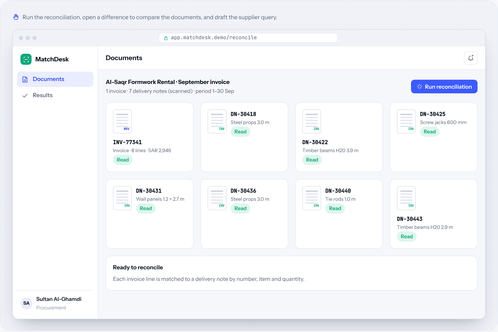
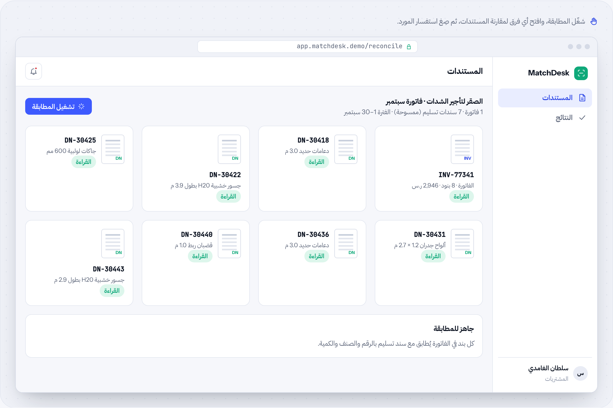

# MatchDesk

**Invoice ↔ delivery note reconciliation** · Document AI · by [HUDERA AI](https://www.linkedin.com/company/hudera)

Reads supplier invoices and scanned delivery notes, matches every line, and drafts the query for anything that doesn't add up.

**[▶ Try the live demo](https://hudera-ai.github.io/matchdesk/)** · runs in your browser on sample data · Arabic & English

## The problem
Monthly supplier invoices are checked against paper delivery notes by hand. Differences are found late, or not at all.

## What it does
MatchDesk extracts lines from the invoice and the scanned delivery notes, matches them by note number, item and quantity, and explains each difference with the documents side by side.

## Business value
Procurement checks every line, not a sample, and sends the supplier a precise query backed by the signed documents.

## Features
| Feature | Details |
| --- | --- |
| Document reading | Invoices and scanned notes |
| Line matching | Number, item, quantity |
| Differences | Quantity and missing notes |
| Side-by-side view | Evidence for each finding |
| Supplier query | Drafted for you |
| Export | Excel summary |

## How the workflow runs
**Upload**: Invoice + notes → **Read**: Extract lines → **Match**: Line by line → **Flag**: Differences → **Act**: Supplier query

## Typical stack
OCR · LLM extraction · Python matching · Web app

## Run it locally
Open `index.html` in any modern browser. No build step, no server, no data leaves your machine.

---

## MatchDesk بالعربي

**مطابقة الفواتير ↔ سندات التسليم**

يقرأ فواتير الموردين وسندات التسليم الممسوحة، ويطابق كل بند، ويصيغ الاستفسار لأي فرق.

### المشكلة
فواتير الموردين الشهرية تُراجع يدوياً مقابل سندات التسليم الورقية، فتُكتشف الفروقات متأخرة أو لا تُكتشف أبداً.

### ما الذي يفعله
يستخرج MatchDesk البنود من الفاتورة وسندات التسليم الممسوحة، ويطابقها برقم السند والصنف والكمية، ويشرح كل فرق مع المستندات جنباً إلى جنب.

### القيمة للأعمال
المشتريات تراجع كل بند وليس عينة، وترسل للمورد استفساراً دقيقاً مدعوماً بالمستندات الموقّعة.

### المزايا
| الميزة | التفاصيل |
| --- | --- |
| قراءة المستندات | فواتير وسندات ممسوحة |
| مطابقة البنود | الرقم، الصنف، الكمية |
| الفروقات | الكميات والسندات المفقودة |
| عرض جنباً إلى جنب | دليل لكل ملاحظة |
| استفسار للمورد | مصاغ لك جاهزاً |
| التصدير | ملخص Excel |

### كيف يسير العمل
**الرفع**: الفاتورة + السندات ← **القراءة**: استخراج البنود ← **المطابقة**: بنداً ببند ← **التنبيه**: الفروقات ← **التنفيذ**: استفسار للمورد

---

## About HUDERA AI
HUDERA AI builds WhatsApp AI assistants, business dashboards, workflow automations and custom SaaS products for companies in Saudi Arabia and the Gulf.

- LinkedIn: [linkedin.com/company/hudera](https://www.linkedin.com/company/hudera)
- Email: hudera.ai@gmail.com
- WhatsApp: [+20 155 515 9139](https://wa.me/201555159139)

> This repository is a product demo. Company names, people and figures inside it are fictional sample data.

© 2026 HUDERA AI. All rights reserved.
